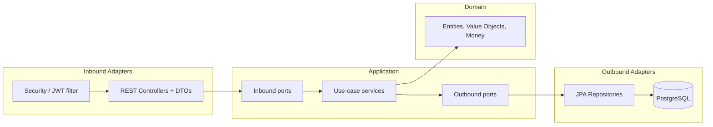
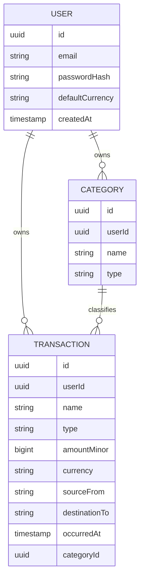
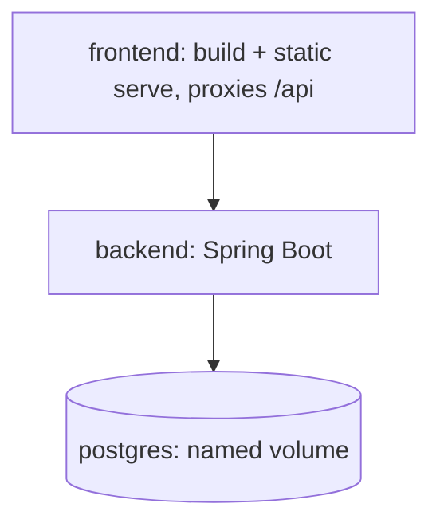

# Design — Finance & Property Management System (FPMS)

## Overview

FPMS is split into a Spring Boot backend (strict hexagonal architecture) and a
React + TypeScript frontend, backed by PostgreSQL, all orchestrated by Docker
Compose. The MVP implements authentication, categories, one-time transactions,
and a monthly statement with per-currency totals.

Design priorities: a framework-free domain core, inward-pointing dependencies,
vertical feature slices, and clean seams for the deferred features (recurring
payments, properties, tax reporting).

## Architecture



### Backend package layout (hexagonal)
```
com.fpms
├── domain                  # pure Java: entities, value objects, no framework imports
│   ├── user
│   ├── category
│   ├── transaction
│   └── money               # Money value object, Currency handling
├── application             # use-case services + ports
│   ├── port.in             # inbound ports (use-case interfaces)
│   ├── port.out            # outbound ports (repository/security interfaces)
│   └── service             # implementations orchestrating domain + ports
├── adapter
│   ├── in.web              # REST controllers, request/response DTOs, mappers
│   └── out.persistence     # JPA entities, Spring Data repos, port implementations
└── config                  # Spring wiring, security, bean configuration
```

Dependency rule: `adapter` → `application` → `domain`. The domain imports nothing
from Spring/JPA. An **ArchUnit** test enforces the direction.

## Domain model (MVP)



### Key domain types
- **Money** — value object: `{ long amountMinor, Currency currency }`. Arithmetic
  guards against mixing currencies; construction validates a non-null ISO 4217
  currency. All monetary math lives here.
- **TransactionType** — enum `INCOME | EXPENSE`.
- **Transaction** — aggregate with identity, owner (`UserId`), `Money`, metadata
  (name, from, to, `occurredAt`), optional `CategoryId`.
- **Category** — owner-scoped classification (name + type).
- **User** — identity, credentials (hash only), `defaultCurrency`.

Value objects `UserId`, `CategoryId`, `TransactionId` wrap UUIDs to keep the
domain explicit and framework-free.

## Money handling

- Stored as `BIGINT amount_minor` + `VARCHAR currency` (ISO 4217).
- No floating point anywhere in storage or domain math.
- The frontend formats using the currency's decimal exponent (e.g. 2 → divide by
  100 for display; 0-decimal currencies display as-is).
- Totals are computed **per currency**; the API never sums across currencies.

## API (MVP)

| Method | Path | Auth | Purpose |
|-------|------|------|---------|
| POST | `/api/auth/register` | no | Create account (email, password, defaultCurrency) |
| POST | `/api/auth/login` | no | Return JWT |
| GET  | `/api/me` | yes | Current user profile (incl. default currency) |
| GET/POST | `/api/categories` | yes | List / create categories |
| PUT/DELETE | `/api/categories/{id}` | yes | Edit / delete a category |
| GET/POST | `/api/transactions` | yes | List / create transactions |
| PUT/DELETE | `/api/transactions/{id}` | yes | Edit / delete a transaction |
| GET | `/api/statement?year=&month=` | yes | Month's transactions + per-currency totals |

All amounts cross the API as integer minor units + currency code. Every data
endpoint is scoped to the authenticated user.

## Security

- Spring Security 6 with a JWT filter; passwords hashed with BCrypt.
- JWT signing secret supplied via environment variable.
- Non-auth endpoints require a valid bearer token; the authenticated `UserId` is
  resolved in the inbound adapter and passed into the application layer. The
  application layer never depends on Spring Security types directly (seam via an
  outbound port for token issuance/validation).

## Persistence & migrations

- Spring Data JPA for the outbound persistence adapter; JPA entities are distinct
  from domain entities, mapped by adapter-level mappers.
- Flyway versioned SQL migrations: `users`, `categories`, `transactions`
  (FK `user_id`, index on `(user_id, occurred_at)`).
- Integration tests use Testcontainers PostgreSQL to run against a real DB.

## Frontend

- Vite `react-ts`; MUI for UI; React Query for server state and cache
  invalidation; a router with protected routes; a thin Axios/fetch API client
  that attaches the JWT and handles 401.
- A currency formatter util converts minor↔major units by currency exponent.
- Screens: Register, Login, and the monthly Statement (list + per-currency
  totals + month navigation + create/edit/delete dialogs for transactions and
  categories). New transactions default to the user's default currency.

## Deployment (Docker Compose)



- Services: `db` (PostgreSQL + named volume + healthcheck), `backend`
  (multi-stage build, runs Flyway on start, waits for healthy db), `frontend`
  (built assets served statically, proxies API).
- All cross-service config and secrets via env vars / `.env`; swapping to an
  external DB is a config change (point the backend at a different host, drop the
  `db` service), not a redesign.

## Testing strategy

- **Domain:** fast unit tests (Money arithmetic, currency guards, invariants).
- **Application:** use-case tests with faked ports.
- **Adapters:** web slice tests for controllers; persistence integration tests
  with Testcontainers.
- **Architecture:** ArchUnit test asserting inward dependency direction.
- **Frontend:** component tests for the currency formatter, auth forms,
  protected-route redirect, and statement rendering/totals (mocked API).

## Seams for deferred features (not built in MVP)

- **Recurring payments:** a future `RecurringTemplate` (amount, currency,
  frequency, due day) with an extensible `Frequency` concept (MONTHLY, YEARLY,
  extensible). Pay windows open at the period boundary (1st of month / Jan 1);
  per-period state pending → payable → paid, with overdue flagging and
  roll-forward to the next period, plus a gentle near-due (~3 days) cue. On-read
  generation materializes a month's obligations when the statement is opened.
- **Properties/assets:** a future `Property` entity; transactions gain optional
  links to a property and/or an income source (rent ties to a property; salary
  does not). Owner-aware schema already supports this.
- **Tax reporting:** downstream reporting over the existing transaction data.
- **Multi-user:** all entities are already owner-aware; enabling multi-user is an
  access/registration concern, not a schema change.
